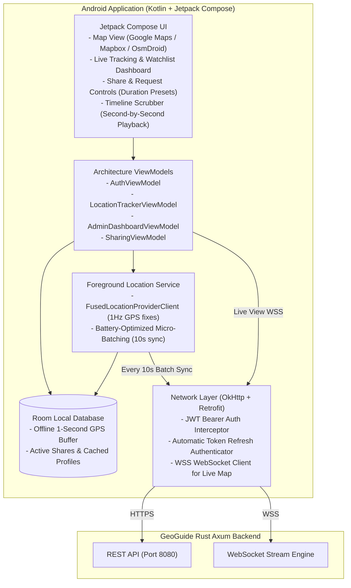

# GeoGuide: Android App Integration & Google AI Studio Guide

This guide is designed so you can copy-paste prompts directly into **Google AI Studio** to generate the complete Android application (Kotlin, Jetpack Compose, Room, Retrofit/Ktor, OkHttp WebSockets).

---

## 1. High-Level Android App Architecture



---

## 2. API Endpoints Reference for Android Client

Base URL: `http://<SERVER_IP>:8080` (or `http://10.0.2.2:8080` when using Android Studio Emulator).

### A. Authentication Module (`/api/v1/auth`)

| Method | Endpoint | Description | Request Body | Headers |
| :--- | :--- | :--- | :--- | :--- |
| `POST` | `/api/v1/auth/register` | Register new user or admin | `{"email": "...", "password": "...", "full_name": "...", "phone": "...", "admin_secret": null}` | None |
| `POST` | `/api/v1/auth/login` | Login with credentials | `{"email": "...", "password": "...", "device_info": "Pixel 8 Pro"}` | None |
| `POST` | `/api/v1/auth/refresh` | Rotate refresh token | `{"refresh_token": "..."}` | None |
| `POST` | `/api/v1/auth/logout` | Revoke session | `{"refresh_token": "..."}` | `Authorization: Bearer <token>` |
| `GET` | `/api/v1/auth/me` | Fetch authenticated user profile | None | `Authorization: Bearer <token>` |
| `PUT` | `/api/v1/auth/tracking-status` | Pause/Resume continuous tracking | `{"is_tracking_enabled": true}` | `Authorization: Bearer <token>` |

### B. Location Telemetry Ingestion (`/api/v1/locations`)

| Method | Endpoint | Description | Request Body |
| :--- | :--- | :--- | :--- |
| `POST` | `/api/v1/locations/single` | Ingest single GPS fix | `{"latitude": 12.9716, "longitude": 77.5946, "speed": 2.5, "accuracy": 3.0, "battery_level": 85, "recorded_at": "2026-11-13T17:00:00Z"}` |
| `POST` | `/api/v1/locations/batch` | Ingest batch of 1-second GPS fixes (battery saver) | `{"fixes": [ {"latitude": ..., "longitude": ..., "recorded_at": ...}, ... ]}` |
| `GET` | `/api/v1/locations/latest` | Retrieve user's latest fix | None |
| `WS` | `/api/v1/ws/location/stream?token=<JWT>` | WebSocket connection for 1 Hz foreground live streaming | Raw JSON of `SingleLocationInputDto` |

### C. Timeline & History (`/api/v1/timeline`)

| Method | Endpoint | Description | Query Parameters |
| :--- | :--- | :--- | :--- |
| `GET` | `/api/v1/timeline/mine` | Query personal second-by-second timeline | `?from=2026-11-13T00:00:00Z&to=2026-11-13T23:59:59Z&limit=5000` |
| `GET` | `/api/v1/timeline/users/{user_id}` | Query authorized peer timeline (must have active share) | `?from=...&to=...&limit=5000` |

### D. Sharing & Permission Controls (`/api/v1/sharing`)

| Method | Endpoint | Description | Request Body |
| :--- | :--- | :--- | :--- |
| `GET` | `/api/v1/sharing/admin-consent` | View current tracking consent given to Admin | None |
| `PUT` | `/api/v1/sharing/admin-consent` | Update admin tracking permissions | `{"allow_live_tracking": true, "allow_timeline_history": true}` |
| `POST` | `/api/v1/sharing/shares` | Create time-limited share to a peer | `{"grantee_id": "<UUID>", "share_type": "BOTH", "duration_minutes": 60}` |
| `GET` | `/api/v1/sharing/shares/active` | List all active (unexpired) shares | None |
| `DELETE` | `/api/v1/sharing/shares/{share_id}` | Instantly revoke active share | None |
| `POST` | `/api/v1/sharing/requests` | Request location access from peer | `{"target_id": "<UUID>", "requested_type": "BOTH", "duration_minutes": 120, "message": "Can I see your route?"}` |
| `GET` | `/api/v1/sharing/requests/inbox` | View incoming pending requests | None |
| `PUT` | `/api/v1/sharing/requests/{id}/respond` | Accept or reject request | `{"approve": true}` |

### E. Admin Dashboard & Watchlist Movement Alerts (`/api/v1/admin`)

| Method | Endpoint | Description | Query / Body |
| :--- | :--- | :--- | :--- |
| `GET` | `/api/v1/admin/users` | List all users and their tracking status | None |
| `GET` | `/api/v1/admin/users/{user_id}/timeline` | Inspect any consenting user's second-by-second timeline | `?from=...&to=...` |
| `POST` | `/api/v1/admin/watchlist` | Select user to watch for movement alerts | `{"user_id": "<UUID>", "movement_threshold_meters": 25.0}` |
| `DELETE` | `/api/v1/admin/watchlist/{user_id}` | Remove user from watchlist | None |
| `GET` | `/api/v1/admin/watchlist` | List currently watched users | None |
| `GET` | `/api/v1/admin/notifications` | View movement alert notifications | `?limit=50&offset=0` |
| `GET` | `/api/v1/admin/audit-logs` | Query system audit logs | `?actor_id=...&action=...` |
| `WS` | `/api/v1/ws/live/{user_id}?token=<JWT>` | Stream live coordinates of consenting user in real time | WebSocket binary/text frames |
| `WS` | `/api/v1/admin/ws/notifications?token=<JWT>` | Stream real-time movement alerts for watched users only | WebSocket JSON alerts |

---

## 3. Ready-to-Use Google AI Studio Prompts

You can paste the prompts below into **Google AI Studio** to generate the Android application code.

### Prompt 1: Project Setup & Networking Layer
```text
Act as a senior Android Kotlin developer. Build an Android application called "GeoGuide" that communicates with a high-performance Rust backend.

Architecture requirements:
1. Target: Android 14+ (API 34), Modern Kotlin, Jetpack Compose, Material 3.
2. Architecture: Clean Architecture + MVVM (Repository pattern, ViewModels, Kotlin Coroutines, StateFlow).
3. Networking: Retrofit 2 + OkHttp 4.
   - Implement an AuthInterceptor that attaches "Authorization: Bearer <access_token>" to authenticated requests.
   - Implement an OkHttp Authenticator that automatically detects 401 Unauthorized, calls POST /api/v1/auth/refresh with the stored refresh_token, updates the DataStore tokens, and retries the failed request seamlessly.
   - Response envelope wrapper: ApiResponse<T> { success: Boolean, data: T?, error: String?, timestamp: String }.
4. Local Storage: Jetpack DataStore for storing JWT access_token, refresh_token, and user profile. Room Database for offline GPS caching.

Generate:
- Network models and DTOs matching the GeoGuide backend spec.
- Retrofit service interfaces for Auth, Locations, Timeline, Sharing, and Admin.
- The TokenManager (DataStore) and OkHttp Authenticator.
```

### Prompt 2: Continuous 1-Second GPS Tracking Foreground Service
```text
Act as a senior Android Kotlin developer. Implement the background location tracking engine for the "GeoGuide" app.

Requirements:
1. Continuous Tracking Requirement: Tracking must run continuously in the background as soon as the user logs in.
2. Foreground Service: Create a Foreground Service named "LocationTrackingService" with a persistent notification (NotificationChannel with FOREGROUND_SERVICE_LOCATION permission).
3. High-Frequency GPS Fixes: Use Google FusedLocationProviderClient configured for PRIORITY_HIGH_ACCURACY, interval 1000ms (1 second), fastestInterval 1000ms.
4. Battery Optimization & Zero Data Loss:
   - Save every 1-second coordinate into a Room DB table (Latitude, Longitude, Altitude, Speed, Accuracy, BatteryLevel, RecordedAt).
   - A background coroutine worker in the service flushes batches of collected points every 10 seconds via POST /api/v1/locations/batch to the Rust backend.
   - If offline or cellular drops, records remain safely queued in Room DB and automatically sync when connectivity returns.
   - Provide a toggle in the UI to pause/resume tracking via PUT /api/v1/auth/tracking-status.

Generate the full Kotlin implementation of LocationTrackingService, the Room DAO, and the syncing worker.
```

### Prompt 3: Real-Time Live Map & Second-by-Second Timeline Playback
```text
Act as a senior Android Kotlin developer. Implement the Jetpack Compose UI for GeoGuide:

1. Live Map Screen (Google Maps / Mapbox Compose):
   - Supports connecting to WebSocket /api/v1/ws/live/{user_id}?token={jwt} to show real-time animated marker movement.
   - For Admin: Map displays all consenting users with status indicators (Moving / Stationary / Battery level).
   - For Users: Shows my own live position and any peer sharing with me.

2. Second-by-Second Timeline Player Screen:
   - Fetches timeline from GET /api/v1/timeline/mine or GET /api/v1/timeline/users/{id}?from={ISO}&to={ISO}.
   - Draws polyline of the path traveled.
   - Contains an interactive time-scrubber slider allowing the user or admin to replay second-by-second movements with Play/Pause/Speed (1x, 2x, 5x) controls.
   - Displays real-time speed, timestamp, and cumulative distance.

3. Sharing & Requests Management Screen:
   - Button to create time-limited shares with duration chips (15m, 1h, 8h, 24h).
   - Inbox of incoming location requests with "Approve" and "Deny" actions.

4. Admin Watchlist & Movement Alerts Screen:
   - Checkbox list of users. Admin can select which users to watch.
   - Real-time alert list connecting to WS /api/v1/admin/ws/notifications.
   - Shows snackbar/notification banner whenever a watched user moves beyond the threshold.

Provide clean, modular Jetpack Compose code with Material 3 components.
```

