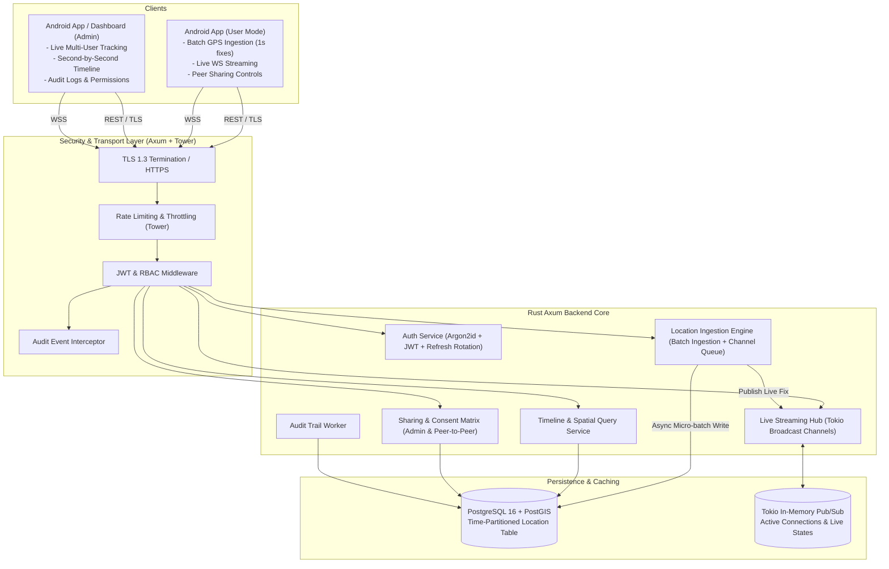
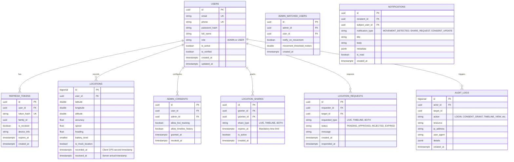
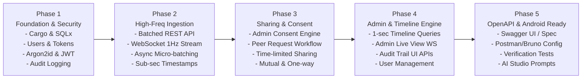

# GeoGuide Backend: High-Performance Rust Architecture & Implementation Plan

This document outlines the complete architectural design, security model, data structures, and phased implementation roadmap for the **GeoGuide** backend. The system is designed in **Rust** to deliver sub-millisecond query responses, high-concurrency GPS ingestion (second-by-second timeline tracking), real-time live map streaming, and enterprise-grade security.

---

## 1. System Architecture Overview



---

## 2. Technology Stack Selection

| Component | Technology | Rationale |
| :--- | :--- | :--- |
| **Language** | **Rust (2021/2024 Edition)** | Zero-cost abstractions, memory safety without garbage collector pauses, ultra-low latency for second-by-second ingestion. |
| **Web Framework** | **Axum 0.7** (Tokio ecosystem) | High performance, composable Tower middleware, native WebSockets, first-class asynchronous state handling. |
| **Async Runtime** | **Tokio** | Industry standard asynchronous multi-threaded work-stealing runtime. |
| **Database & Spatial** | **PostgreSQL 16 + PostGIS** (or TimescaleDB) | Standard for geospatial coordinate indexing (`ST_MakePoint`, `ST_DWithin`) and declarative time partitioning for millions of GPS records. |
| **Database Driver** | **SQLx (Async & Pure Rust)** | Compile-time SQL checking, connection pooling, prepared statements to prevent SQL injections. |
| **Password Hashing** | **Argon2id** (`argon2` crate) | OWASP recommended password hashing algorithm, resistant to GPU/ASIC brute-force attacks. |
| **Token System** | **JWT (`jsonwebtoken`) + Opaque Refresh Tokens** | Stateless 15-minute access tokens + cryptographically random refresh tokens with automatic token family reuse detection. |
| **Encryption** | **AES-256-GCM / ChaCha20-Poly1305** (`ring` / `aes-gcm`) | Field-level encryption for sensitive PII and confidential location metadata. |
| **API Contract / Spec**| **utoipa + utoipa-swagger-ui** | Auto-generates OpenAPI 3.1 specification directly from Rust handler types, enabling effortless Kotlin/Java client generation in Google AI Studio. |

---

## 3. High-Frequency Second-by-Second Location Strategy

Tracking location every single second presents unique mobile battery and network constraints:

### A. Mobile-Friendly Dual Ingestion Strategy
1. **Active Live Mode (Screen On / Navigation Active)**:
   - Device connects to **WebSocket endpoint** (`/api/v1/ws/location/stream`).
   - Android client pushes location packets at 1 Hz.
   - The backend publishes coordinates immediately to active subscribers (Admin or permitted peers) via Tokio broadcast channels while forwarding to an asynchronous DB micro-batching buffer.
2. **Background Timeline Mode (Battery Saver / Screen Off)**:
   - Android client captures 1-second GPS fixes into a local SQLite/Room database.
   - Android transmits batches of 5–15 fixes every 5–15 seconds via **Batch REST endpoint** (`POST /api/v1/locations/batch`).
   - Guaranteed zero data loss across mobile network transitions (e.g., tunnels, cellular handovers).

### B. Ingestion Micro-Batching on Server
To easily handle thousands of 1-second records without bottlenecking Postgres:
- Ingestion handlers push incoming records into an in-memory `tokio::sync::mpsc` channel.
- A dedicated background worker flushes buffered fixes in multi-row batches (or PostgreSQL `COPY`) every 100ms or when batch size hits 250 items.

---

## 4. Database Schema Design



---

## 5. Security & Permission Architecture

### 1. Authentication & Session Management
- **Password Security**: Argon2id with memory cost 64MB, iterations 3, parallelism 1.
- **Access Tokens**: Short-lived (15 minutes), containing `sub` (User UUID), `role` (`ADMIN` | `USER`), `session_id`, `exp`.
- **Refresh Tokens**: Opaque 256-bit cryptographically secure strings stored as SHA-256 hashes.
- **Family Rotation**: If an expired or already-used refresh token is presented, the entire token family is immediately revoked to thwart token theft.

### 2. Multi-Tier Permission & Sharing Matrix

| Requester | Target Resource | Permission Condition Checked by Backend |
| :--- | :--- | :--- |
| **Admin** | User Live Stream | User has active `ADMIN_CONSENTS` where `allow_live_tracking = true` |
| **Admin** | User Timeline History | User has active `ADMIN_CONSENTS` where `allow_timeline_history = true` |
| **User A** | User B Live Stream | Active row in `LOCATION_SHARES` (Granter: B, Grantee: A, `share_type` in `[LIVE, BOTH]`, `now() < expires_at`) |
| **User A** | User B Timeline | Active row in `LOCATION_SHARES` (Granter: B, Grantee: A, `share_type` in `[TIMELINE, BOTH]`, `now() < expires_at`) |
| **User A** | Request User B's Location | Triggers `LOCATION_REQUESTS` pending notification for User B |
| **User** | User's Own Location | Full read/write access to self |

### 3. Audit Logging & Non-Repudiation
Every security-sensitive operation writes an asynchronous audit entry:
- Authentication events (successful login, failed attempts, token refresh, logout)
- Admin consent toggles (granted, modified, revoked)
- Peer share creation, approvals, rejections, revocations
- Admin timeline inspections (who viewed whose location history and the exact timestamp range queried)

---

## 6. Android REST & WebSocket API Specification

All REST endpoints return standard envelopes:
```json
{
  "success": true,
  "data": { ... },
  "error": null,
  "timestamp": "2026-11-13T16:15:00Z"
}
```

### Module 1: Authentication (`/api/v1/auth`)
- `POST /register`: Register new user account.
- `POST /login`: Authenticate with credentials; returns JWT Access Token + HTTP-only/secure Refresh Token.
- `POST /refresh`: Rotate refresh token and obtain fresh access token.
- `POST /logout`: Invalidate refresh token session.
- `GET  /me`: Fetch authenticated profile & role information.

### Module 2: Location Ingestion (`/api/v1/locations`)
- `POST /batch`: Upload an array of GPS fixes (second-by-second timestamps, lat, lon, alt, accuracy, speed, battery, `is_mock`).
- `POST /single`: Upload a single point.
- `GET  /latest`: Get authenticated user's latest recorded location.
- `WS   /stream`: WebSocket channel for 1 Hz foreground streaming.

### Module 3: Timeline & History (`/api/v1/timeline`)
- `GET  /mine?from=ISO&to=ISO&resolution=sec`: Query personal timeline down to the second with cursor pagination.
- `GET  /users/:user_id?from=ISO&to=ISO`: Query authorized peer timeline (validated against `LOCATION_SHARES`).

### Module 4: Sharing & Permission Controls (`/api/v1/sharing`)
- **Admin Consent**:
  - `GET  /admin-consent`: Retrieve current consent status given to Admin.
  - `PUT  /admin-consent`: Update consent settings (`allow_live_tracking`, `allow_timeline_history`). Default is enabled upon registration for instant continuous tracking.
- **Time-Limited Peer Sharing**:
  - `POST /shares`: Grant direct live or timeline access to another user (**requires explicit expiry duration**: 15m, 1h, 8h, 24h, custom up to max policy).
  - `GET  /shares/active`: List all non-expired users sharing with me or receiving my shares.
  - `DELETE /shares/:share_id`: Instantly revoke an active share before expiry.
- **Location Requests**:
  - `POST /requests`: Request location access from another user (specifying duration & type).
  - `GET  /requests/inbox`: View incoming pending requests.
  - `PUT  /requests/:id/respond`: Accept (with duration) or reject a request.

### Module 5: Admin Panel, Watchlists & Movement Notifications (`/api/v1/admin`)
- `GET  /users`: List registered users with last seen timestamp, battery, movement status, and consent flags.
- `GET  /users/:id/timeline?from=ISO&to=ISO`: Inspect any consenting user's high-resolution timeline (second-by-second).
- `WS   /live/:user_id`: Connect to live real-time coordinate feed of a consenting user.
- **Watched Users & Movement Alerts**:
  - `POST /watchlist/:user_id`: Add user to Admin's active watch list (with optional movement threshold in meters, default 25m).
  - `DELETE /watchlist/:user_id`: Remove user from Admin's watch list.
  - `GET  /watchlist`: List currently watched users and their last movement alert.
  - `WS   /ws/notifications`: Real-time WebSocket event feed streaming movement alerts for watched users only.
  - `GET  /notifications?page=1&limit=50`: Paginated history of movement alerts and security notifications.
- `GET  /audit-logs?page=1&limit=50`: Search and filter comprehensive security and access logs.
- `PUT  /users/:id/status`: Deactivate or activate user accounts.

---

## 7. Project Codebase Layout

```text
d:\GeoGuide\
├── Cargo.toml
├── migrations/
│   ├── 001_create_users_and_tokens.sql
│   ├── 002_create_locations_and_indexes.sql
│   ├── 003_create_sharing_and_consents.sql
│   └── 004_create_audit_logs.sql
├── src/
│   ├── main.rs                   # App initialization, database pool, HTTP server
│   ├── config.rs                 # Environment variables, security configs
│   ├── error.rs                  # Centralized typed error definitions (AppResult)
│   ├── common/
│   │   ├── mod.rs
│   │   └── response.rs           # Standardized API response format
│   ├── security/
│   │   ├── mod.rs
│   │   ├── password.rs           # Argon2id hashing & verification
│   │   ├── jwt.rs                # JWT encoding, decoding, validation
│   │   └── encryption.rs         # AES-GCM / ChaCha20 encryption utilities
│   ├── middleware/
│   │   ├── mod.rs
│   │   ├── auth.rs               # JWT extractor & Role authorization guard
│   │   ├── rate_limit.rs         # Rate limiting interceptor
│   │   └── audit.rs              # Request auditing middleware
│   ├── domain/
│   │   ├── mod.rs
│   │   ├── user.rs
│   │   ├── location.rs
│   │   ├── sharing.rs
│   │   └── audit.rs
│   ├── repository/               # Database operations (SQLx queries)
│   │   ├── mod.rs
│   │   ├── user_repo.rs
│   │   ├── location_repo.rs
│   │   ├── sharing_repo.rs
│   │   └── audit_repo.rs
│   ├── services/                 # Business logic & validations
│   │   ├── mod.rs
│   │   ├── auth_service.rs
│   │   ├── location_service.rs   # Ingestion, micro-batching, timeline queries
│   │   ├── streaming_service.rs  # Real-time WebSocket pub/sub engine
│   │   ├── sharing_service.rs    # Consent & request management
│   │   └── audit_service.rs
│   └── api/                      # REST & WebSocket route handlers
│       ├── mod.rs
│       ├── auth_handlers.rs
│       ├── location_handlers.rs
│       ├── timeline_handlers.rs
│       ├── sharing_handlers.rs
│       ├── admin_handlers.rs
│       └── ws_handlers.rs
└── tests/
    ├── auth_tests.rs
    ├── location_ingestion_tests.rs
    └── sharing_permissions_tests.rs
```

---

## 8. Step-by-Step Implementation Roadmap



### Phase Details:
- **Phase 1: Project Scaffolding & Cryptographic Authentication**
  - Setup Rust project dependencies (`axum`, `tokio`, `sqlx`, `argon2`, `jsonwebtoken`, `utoipa`, `tracing`).
  - Database schema migrations for users, refresh tokens, and audit logs.
  - Implement Argon2id password hashing, JWT claims verification, refresh token family rotation, and auth middleware.
- **Phase 2: High-Frequency Location Ingestion & Live Streaming**
  - Implement location data models supporting client GPS time down to millisecond/second accuracy.
  - Build batch ingestion endpoint (`POST /locations/batch`) and live WebSocket streaming handler.
  - Asynchronous memory buffer to flush coordinates in micro-batches to Postgres.
- **Phase 3: Permission Matrix & Mutual/One-Way Peer Sharing**
  - Implement admin consent toggle (`allow_live_tracking`, `allow_timeline_history`).
  - Implement user-to-user request/accept/reject flow and active share management.
  - Granular authorization checks enforcing active shares before serving any location data.
- **Phase 4: Admin Controls & High-Resolution Timeline Engine**
  - High-performance timeline queries with temporal filtering (`from` / `to`), resolution sampling, and bounding box support.
  - Real-time multi-user live tracking WebSocket for admin dashboard.
  - Administrative audit log query endpoints.
- **Phase 5: OpenAPI Documentation & Android Integration Artifacts**
  - Generate full OpenAPI 3.1 specification (`/swagger-ui`) containing all schemas and endpoints.
  - Provide ready-to-use prompt templates for Google AI Studio to generate the Android Jetpack Compose + Room + Retrofit client application.
